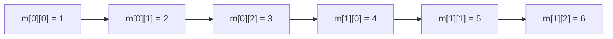

# Array, matrici e `struct` — lezione mirata per la prova teorica

**Obiettivo:** raccogliere i dettagli su array, matrici e strutture discussi durante la preparazione alla teoria di Programmazione 1, con esempi tratti dalle prove e indicazioni sugli errori tipici.

**Materiale di riferimento:** dispense **4.1 Array** e **5.1 Tipi di dati**; prove del [10/02/2025, domanda 3](../../Prove_Teoriche/100225%20ProvaTeorica%20PROG1.pdf) e del [22/10/2024, domanda 6](../../Prove_Teoriche/22102024%201_ProvaTeorica%20PROG1.pdf). Le parti sull'organizzazione in memoria e sui tipi puntatore sono approfondimenti tecnici collegati agli argomenti studiati; gli esempi **didattici** non vanno confusi con i testi originali degli esami.

**Fuori ambito:** passaggio di array e puntatori alle funzioni (da trattare nella lezione **Funzioni**). Cicli annidati, figure, scambi, trasposizione e simmetria sono già sviluppati nella [lezione Cicli](../Cicli/README.md).

---

## 1. Inizializzazione completa, parziale e assente

```c
int a[5] = {5, 2, -5, 10, 234};
int b[4] = {5, 2, -5};
int c[4] = {0};
int d[4];
```

| Dichiarazione | Contenuto iniziale |
|---|---|
| `a` | `{5, 2, -5, 10, 234}` |
| `b` | `{5, 2, -5, 0}` |
| `c` | `{0, 0, 0, 0}` |
| `d` | **Indeterminato**, se `d` è un array locale automatico |

**Regola d'esame:** quando un array ha una lista di inizializzazione **parziale**, i restanti elementi vengono inizializzati a zero. Non è la stessa situazione di una variabile locale senza inizializzatore.

```c
int v[5];           // valori indeterminati (se locale automatico)
int w[5] = {7};     // {7, 0, 0, 0, 0}
static int z[5];    // {0, 0, 0, 0, 0}
```

(L'esempio con `static` e la sua inizializzazione automatica a zero è una precisazione non esplicitata nelle slide sugli array.)

Se il testo chiede di inserire `ND` per valori non determinabili:
- Gli elementi **omessi** da una lista di inizializzazione **non** sono `ND`: diventano zero.
- Gli elementi di un array locale **senza inizializzazione** non hanno un valore iniziale determinabile (quindi `ND`, finché non vengono assegnati).
- Le variabili con durata statica sono inizializzate a zero anche in assenza di un inizializzatore esplicito.

## 2. Esercizio reale — 10/02/2025, domanda 3 (1 punto)

**Fonte:** [prova teorica del 10/02/2025](../../Prove_Teoriche/100225%20ProvaTeorica%20PROG1.pdf).

Il compito presenta il seguente codice e chiede di ricostruire la matrice, indicando `ND` se il valore non è determinabile:

```c
#define NR 4
#define NC 3

int m[NR][NC] = {
    {1, 3},
    {},
    {1, 0, 0},
    {2, -1}
};
```

**Risultato:**

```text
         col0 col1 col2
riga 0     1    3    0
riga 1     0    0    0
riga 2     1    0    0
riga 3     2   -1    0
```

**Come ragionare:**
1. `{1, 3}` inizializza due elementi della prima riga: il terzo è `0`.
2. `{}` inizializza a zero gli elementi della seconda riga.
3. `{1, 0, 0}` contiene tutti e tre gli elementi della terza riga.
4. `{2, -1}` inizializza due elementi della quarta riga: il terzo è `0`.

**Non c'è alcun `ND` nella risposta.**

> **Attenzione allo standard:** l'inizializzatore vuoto `{}` è valido in C23 e in C++; nelle precedenti versioni standard del C non è ammesso (salvo estensioni). Nell'esercizio va interpretato secondo l'intenzione del testo d'esame: tutti zeri. Per scrivere una riga completamente azzerata compatibile anche con C precedenti, si può usare `{0}`. (**La precisazione su C23/C++ non è spiegata nelle slide; la sintassi `{}` compare nel testo d'esame.**)

## 3. Matrici e parentesi graffe: con e senza raggruppamento

Una matrice di C è un **array di righe**, in cui ogni riga è a sua volta un array. Gli elementi sono memorizzati **in ordine per righe** (*row-major*).

### Senza parentesi interne

```c
int m[2][3] = {1, 2, 3, 4};
```

La sequenza di inizializzatori si distribuisce nell'ordine degli elementi:

```text
m[0] -> [ 1 ][ 2 ][ 3 ]
m[1] -> [ 4 ][ 0 ][ 0 ]
```

Equivale a:

```c
int m[2][3] = {
    {1, 2, 3},
    {4, 0, 0}
};
```

### Con parentesi interne

```c
int m[2][3] = {
    {1, 2},
    {3, 4}
};
```

Il contenuto è invece:

```text
m[0] -> [ 1 ][ 2 ][ 0 ]
m[1] -> [ 3 ][ 4 ][ 0 ]
```

Le parentesi **separano le righe**. L'inizializzazione parziale completa ciascuna riga con zeri.

### Schema della memorizzazione



Gli indirizzi degli interi consecutivi differiscono di `sizeof(int)` byte.

## 4. Dimensioni implicite: righe deducibili, colonne necessarie

| Dichiarazione | Valida? | Osservazione |
|---|---|---|
| `int a[3][2];` | **Sì** | Entrambe le dimensioni indicate |
| `int a[][2] = {1, 2, 3, 4};` | **Sì** | Il numero di righe viene dedotto: 2 |
| `int a[2][] = {1, 2, 3, 4};` | **No** | Manca la dimensione interna (colonne) |
| `int a[][] = {1, 2, 3, 4};` | **No** | Mancano le dimensioni necessarie |
| `int a[2][3] = {{1}, {2}};` | **Sì** | Le celle mancanti sono zero |
| `int a[2][3] = {{1, 2, 3, 4}};` | **No** | Troppi elementi per la prima riga |

```c
int m[][2] = {
    {1, 2},
    {3, 4},
    {5, 6}
};                   // int m[3][2]
```

**Perché è necessario conoscere le colonne?** Per sapere quanto spazio occupa **ogni riga** e quindi raggiungere correttamente la riga successiva. Questo diventa particolarmente evidente con l'aritmetica dei puntatori, trattata nella sezione 8.

## 5. Indici, dimensioni e accessi fuori limite

```c
int m[3][4];
```

Gli indici ammessi sono:
- riga `i`: `0 <= i < 3`;
- colonna `j`: `0 <= j < 4`.

```c
m[2][3] = 5;    // valido
m[3][0] = 5;    // fuori dai limiti: riga 3 inesistente
m[1][4] = 5;    // fuori dai limiti: colonna 4 inesistente
```

Gli accessi fuori dai limiti producono **comportamento indefinito**, non necessariamente un errore di compilazione o un arresto del programma.

Anche se tutti gli interi della matrice sono contigui in memoria, **`m[1][4]` non è un modo valido per accedere a `m[2][0]`**.

## 6. `typedef` per array e matrici

`typedef` assegna un nome a un **tipo**: la sola definizione del tipo non crea un array.

```c
typedef int Matrice[3][4];

Matrice a;       // equivalente a: int a[3][4];
```

La definizione può essere composta:

```c
typedef int Riga[4];
typedef Riga Matrice[3];

Matrice a;       // matrice 3 × 4
```

**Attenzione:** `typedef` non inizializza la memoria. Se `a` è una variabile locale automatica senza inizializzatore, il contenuto iniziale non è determinato.

## 7. Assegnazione di array e assegnazione di `struct`

### In C, due array non si assegnano direttamente

```c
int a[3] = {1, 2, 3};
int b[3] = {4, 5, 6};

a = b;            // non valido
```

La copia elemento per elemento è invece valida:

```c
for (int i = 0; i < 3; i++) {
    a[i] = b[i];
}
```

È possibile anche copiare array di dimensioni compatibili con `memcpy` (`<string.h>`), quando gli oggetti e le aree di memoria rispettano le relative condizioni (**funzione `memcpy` non presente nelle slide: approfondimento facoltativo**):

```c
#include <string.h>

memcpy(a, b, sizeof a);
```

### Le strutture dello stesso tipo, invece, sono assegnabili

```c
typedef struct {
    int x, y;
} Punto;

Punto a = {1, 2};
Punto b = {3, 4};
a = b;  // valido
```

E **anche gli array contenuti in una struttura vengono copiati** quando si assegna la struttura intera:

```c
typedef struct {
    int valori[3];
} Dati;

Dati a = {{1, 2, 3}};
Dati b = {{4, 5, 6}};

a = b;  // valido; a.valori ora contiene {4, 5, 6}
```

| Espressione | Ammessa? |
|---|---|
| `arrayA = arrayB;` | **No**, gli array non sono assegnabili |
| `structA = structB;` (stesso tipo) | **Sì** |
| `arrayA[i] = arrayB[i];` (elementi assegnabili) | **Sì** |
| `structA.campoArray = structB.campoArray;` | **No**, il campo è comunque un array |

## 8. Perché `int (*p)[3] = m` è valido, e `int **q = m` no?

(**Approfondimento tecnico non sviluppato esplicitamente nelle slide**: la distinzione fra puntatore a un'intera riga `int (*)[3]` e doppio puntatore `int **` applica le regole sugli array e sui puntatori trattate nel corso.)

**Questo è uno dei dettagli più importanti dell'approfondimento.**

```c
int m[2][3] = {
    {1, 2, 3},
    {4, 5, 6}
};
```

`m` **non** contiene puntatori alle righe. È una matrice costituita da due elementi di tipo **`int [3]`**, ossia due righe consecutive da tre interi:

```text
m (tipo int [2][3])
 |
 +-- m[0] (tipo int [3]) ---> [ 1 ][ 2 ][ 3 ]
 |
 +-- m[1] (tipo int [3]) ---> [ 4 ][ 5 ][ 6 ]
```

### La conversione automatica array-to-pointer

Nella maggior parte delle espressioni, un array viene convertito in un puntatore **al suo primo elemento**. Questa regola del linguaggio si chiama *array-to-pointer conversion* (o *array decay*).

```c
int a[5] = {10, 20, 30, 40, 50};
int *p = a;                // equivalente a &a[0]
```

Lo stesso succede con `m`, **ma il primo elemento di `m` è una riga, non un intero**:

```c
int (*p)[3] = m;           // equivalente a: int (*p)[3] = &m[0];
```

La sintassi `int (*p)[3]` significa **puntatore a un array di tre `int`**. Il **3 descrive la dimensione della riga** perché la riga è il tipo dell'elemento di `m`. Il **2 indica quante righe contiene `m`**, ma non deve comparire nel tipo del puntatore alla singola riga.

```c
p[0][0];                   // 1
p[0][2];                   // 3
p[1][0];                   // 4
p[1][2];                   // 6
p + 1;                     // puntatore alla seconda riga
```

**Perché il compilatore deve conoscere `[3]`?** `p + 1` avanza di **un oggetto del tipo puntato**, cioè di un array di 3 interi. Pertanto si sposta di `3 * sizeof(int)` byte e non di un singolo intero.

### Perché `int **q = m` non è valido

`int **` è un **puntatore a un oggetto di tipo `int *`**. Un'espressione di tipo `int (*)[3]`, invece, è un **puntatore a un array di 3 interi**. I due tipi sono diversi e non compatibili per questa inizializzazione.

Una struttura rappresentata tramite `int **` potrebbe avere questo aspetto (per esempio quando allocata con righe separate):

```text
q  ---> [ indirizzo riga 0 ] ----> [ 1 ][ 2 ][ 3 ]
        [ indirizzo riga 1 ] ----> [ 4 ][ 5 ][ 6 ]
```

La matrice `m` precedente **non** ha quell'array di indirizzi: ha soltanto le due righe di interi, direttamente una dopo l'altra.

| Espressione | Tipo prima dell'eventuale conversione | In un'espressione usuale |
|---|---|---|
| `m` | `int [2][3]` | `int (*)[3]` — puntatore alla prima riga |
| `m[0]` | `int [3]` | `int *` — puntatore al primo intero della prima riga |
| `m[0][0]` | `int` | `int` |
| `&m[0]` | `int (*)[3]` | Puntatore alla prima riga |
| `&m` | `int (*)[2][3]` | Puntatore alla matrice intera |

Quindi:

```c
int (*p)[3] = m;   // VALIDO: puntatore a riga di 3 interi
int *q = m[0];     // VALIDO: puntatore al primo intero della riga 0
int **r = m;       // NON VALIDO: m non è un array di int *
int (*s)[2] = m;   // NON VALIDO: tipo della riga incompatibile
```

**Attenzione alle parentesi:**

```c
int (*p)[3];       // p è puntatore a array di 3 int
int *p2[3];        // p2 è array di 3 puntatori a int
```

Questi due tipi hanno significati e organizzazione in memoria diversi.

**Nota importante:** `m` non «diventa per sempre» un puntatore. È l'espressione `m` che viene convertita nei contesti in cui il linguaggio lo prevede; il suo tipo dichiarato rimane `int [2][3]`. In particolare `sizeof(m)` continua a misurare **l'intero array**, non un puntatore.

### Due forme di indicizzazione

```c
m[i][j] == *(*(m + i) + j)
```

La prima indicizzazione seleziona la **riga**; la seconda seleziona il **singolo intero**. La stessa sintassi a due indici non implica che la matrice sia un `int **`.

## 9. `sizeof` delle matrici

(Gli esempi specifici con `sizeof` applicato a righe e matrici sono un **approfondimento non illustrato esplicitamente nelle slide**; l'operatore `sizeof` è invece presente nelle dispense.)

```c
int m[2][3] = {
    {1, 2, 3},
    {4, 5, 6}
};
```

Assumendo `sizeof(int) == 4`:

| Espressione | Risultato | Motivo |
|---|---:|---|
| `sizeof(m)` | 24 byte | 2 righe × 3 colonne × 4 byte |
| `sizeof(m[0])` | 12 byte | Un'intera riga = 3 interi |
| `sizeof(m[0][0])` | 4 byte | Un singolo intero |

Da qui:

```c
sizeof(m) / sizeof(m[0])          // 2: righe
sizeof(m[0]) / sizeof(m[0][0])    // 3: colonne
```

Si tratta di un calcolo valido finché si lavora direttamente su un array con tipo e dimensioni note. Se invece la variabile è un semplice puntatore, `sizeof(p)` restituisce la dimensione **del puntatore**.

Approfondimento collegato: [Puntatori.md](../Puntatori/Puntatori.md).

## 10. Array di `struct` — esercizio reale 22/10/2024, domanda 6 (1,5 punti)

**Fonte:** [prima prova teorica del 22/10/2024](../../Prove_Teoriche/22102024%201_ProvaTeorica%20PROG1.pdf).

Il compito presenta:

```c
#define N 10

typedef struct Dato {
    float valore;
    int indice;
} Dato;

Dato dati[N];
```

**Richiesta:** scrivere un algoritmo che stampi quanti elementi hanno `indice < 5` e quanti hanno `valore` compreso tra `-1.5` e `+1.5`, **estremi inclusi**.

**Soluzione** (supponendo che l'array `dati` sia stato popolato):

```c
int contaIndici = 0;
int contaValori = 0;

for (int i = 0; i < N; i++) {
    if (dati[i].indice < 5)
        contaIndici++;

    if (dati[i].valore >= -1.5 &&
        dati[i].valore <= 1.5)
        contaValori++;
}

printf("%d %d\n", contaIndici, contaValori);
```

**Attenzioni principali:**
- `dati[i]` è una `struct Dato`; quindi il campo si accede con `dati[i].campo`.
- I **due conteggi sono indipendenti**: servono due `if` distinti, non un `if` seguito da `else if`.
- Gli estremi inclusi richiedono `>=` e `<=`.
- Una variabile locale `Dato dati[N];` appena dichiarata non contiene automaticamente valori inizializzati: il programma deve averne assegnato i campi prima dei confronti.

Questo esercizio combina **array + `struct` + condizioni + cicli**.

## 11. Variable Length Arrays (VLA): array di lunghezza variabile

La dispensa **4.1 Array** introduce gli array a lunghezza variabile, presenti in **C99** e soggetti alle regole di supporto dei successivi standard C (**la precisazione sul supporto negli standard successivi non è trattata nelle slide**).

```c
int n = 5;
int a[n];     // dimensione determinata a esecuzione
```

Non è la stessa cosa di un array con dimensione fissata da un'espressione costante. Per un VLA automatico, la dimensione deve risultare valida (maggiore di zero) quando la dichiarazione viene eseguita.

**Confronto concettuale con la memoria dinamica** (**le funzioni `malloc` e `free` non compaiono nelle slide caricate; questo confronto è un approfondimento**):

```c
#include <stdlib.h>

int n = 5;
int a[n];                         // VLA automatico
int *p = malloc(n * sizeof *p);   // memoria dinamica
if (p != NULL) {
    /* usa p */
    free(p);
}
```

Il VLA automatico termina la propria durata al termine del blocco; la regione acquisita con `malloc` va liberata con `free`. **Non chiamare `free(a)`**.

Nelle domande d'esame specificamente verificate per questo documento **non è emerso un esercizio diretto sui VLA**. Sono quindi secondari rispetto all'inizializzazione e agli accessi alle matrici.

## 12. Riepilogo dei casi che fanno sbagliare all'esame

| Caso | Risposta / dettaglio |
|---|---|
| `int a[5];` locale automatico | Valori indeterminati |
| `int a[5] = {2};` | `{2, 0, 0, 0, 0}` |
| `static int a[5];` | Tutti zeri |
| `int m[2][3] = {1,2,3,4};` | Righe `{1,2,3}`, `{4,0,0}` |
| `int m[2][3] = {{1,2},{3,4}};` | Righe `{1,2,0}`, `{3,4,0}` |
| `int m[][3] = {{1},{2}};` | Due righe dedotte, tre colonne |
| `int m[2][];` | Tipo della riga incompleto: non valido |
| `typedef int M[3][4];` | Definizione di un alias di tipo array |
| `a = b;` con `a`, `b` array | Non valido |
| `a = b;` con `a`, `b` struct dello stesso tipo | Valido, anche con campi array |
| `m[i][j]` | Riga `i`, colonna `j` |
| Accesso fuori dai limiti | Comportamento indefinito |
| `int (*p)[3] = m;` con `m[2][3]` | Valido: puntatore alla prima riga |
| `int **p = m;` con `m[2][3]` | Non valido: `m` non contiene puntatori alle righe |
| `sizeof(m)` | Dimensione dell'intera matrice se `m` è davvero un array |

### Riferimenti

- **Dispensa 4.1 Array (1).pdf** — dichiarazioni, inizializzazioni, array multidimensionali, VLA, accessi ed esercizi.
- **Dispensa 5.1 TipiDiDati(1).pdf** — tipi definiti dall'utente, `typedef` e `struct`.
- **[10/02/2025, domanda 3](../../Prove_Teoriche/100225%20ProvaTeorica%20PROG1.pdf)** — inizializzazione di matrice 4 × 3, celle implicite e `ND`.
- **[22/10/2024, domanda 6](../../Prove_Teoriche/22102024%201_ProvaTeorica%20PROG1.pdf)** — conteggi condizionati su array di `struct`.
- **[Cicli](../Cicli/README.md)** — scansioni, scambi e trasposizioni con doppi cicli.
- **[Puntatori](../Puntatori/Puntatori.md)** — aritmetica, array-to-pointer, doppia indirezione, `sizeof` e memoria.

**Nota di metodo:** sono raccolti gli esempi effettivamente discussi e alcune domande d'esame verificate; non è una rassegna esaustiva di tutti gli appelli. Gli array come argomenti di funzione saranno approfonditi separatamente.
