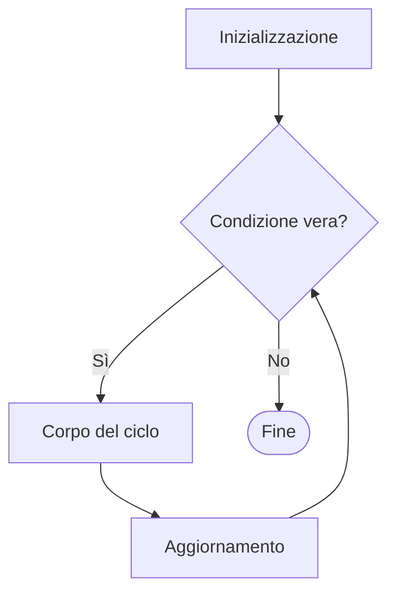

# Cicli in C — appunti mirati per la teoria

Riepilogo delle regole e degli esempi discussi, con particolare attenzione alle domande **«Qual è l'output esatto?»**.

**Riferimento d'esame:** [Prima prova teorica, 22 ottobre 2024](../../Prove_Teoriche/22102024%201_ProvaTeorica%20PROG1.pdf) (domande 2 e 3).  
**Dispense di riferimento:** `3.3 StruttureControllo` e `2.2 Introduzione al C`.

## 1. Esecuzione di un `for`

```c
for (inizializzazione; condizione; aggiornamento) {
    // corpo del ciclo
}
```

1. **Inizializzazione**: una sola volta.
2. **Condizione**: prima di ogni iterazione; se falsa, il ciclo termina.
3. **Corpo**: eseguito quando la condizione è vera.
4. **Aggiornamento**: dopo il corpo, anche se nel corpo viene modificata la variabile di controllo.
5. Si torna al controllo della condizione.

### Diagramma di flusso

Il diagramma Mermaid è renderizzato direttamente da GitHub.



### Esempio base

```c
int i;
for (i = 0; i < 5; i++) {
    printf("%d ", i);
}
```

**Output:** `0 1 2 3 4`

Il valore `5` non viene stampato: il confronto `5 < 5` è falso **prima** di eseguire il corpo.

## 2. `i++` contro `++i`

- `i++` (**post-incremento**): produce il valore corrente di `i`, poi la incrementa.
- `++i` (**pre-incremento**): incrementa `i`, poi produce il nuovo valore.

Partendo separatamente da `i = 3`:

| Espressione | Valore stampato | Valore finale di `i` |
|---|---:|---:|
| `printf("%d", i++);` | 3 | 4 |
| `printf("%d", ++i);` | 4 | 4 |

### Dettaglio importante: incremento nell'aggiornamento del `for`

Questi due cicli stampano entrambi `0 1 2 3 4`:

```c
for (int i = 0; i < 5; i++) {
    printf("%d ", i);
}

for (int i = 0; i < 5; ++i) {
    printf("%d ", i);
}
```

**Perché?** Il terzo campo del `for` viene sempre valutato **dopo** il corpo del ciclo. Quando l'aggiornamento consiste soltanto in `i++` o `++i`, il valore prodotto dall'espressione è scartato: interessa solo il suo effetto, cioè aumentare `i` di 1.

Questo **non** vuol dire che `++i` nell'intestazione venga eseguito prima del corpo: la posizione nel `for` determina *quando* si esegue l'aggiornamento, mentre pre/post-incremento determina il valore prodotto dall'espressione.

## 3. Tracciare i cicli con due aggiornamenti

### Esempio A — `i++` nel corpo e nell'aggiornamento

```c
int i, n = 10;
for (i = 0; i < n; i++) {
    printf("%d ", i++);
}
```

**Output:** `0 2 4 6 8`

| Iterazione | `i` all'inizio | Valore stampato | Dopo `i++` nel `printf` | Dopo l'aggiornamento del `for` |
|---|---:|---:|---:|---:|
| 1 | 0 | 0 | 1 | 2 |
| 2 | 2 | 2 | 3 | 4 |
| 3 | 4 | 4 | 5 | 6 |
| 4 | 6 | 6 | 7 | 8 |
| 5 | 8 | 8 | 9 | 10 |
| Fine | 10 | — | — | — |

### Esempio B — `++i` nel corpo e nell'aggiornamento

```c
int i;
for (i = 0; i < 5; ++i) {
    printf("%d ", ++i);
}
```

**Output:** `1 3 5`

| Iterazione | `i` al controllo | `i < 5` | Valore stampato dal `++i` | `i` dopo aggiornamento `for` |
|---|---:|---|---:|---:|
| 1 | 0 | Vero | 1 | 2 |
| 2 | 2 | Vero | 3 | 4 |
| 3 | 4 | Vero | 5 | 6 |
| Fine | 6 | Falso | — | — |

**Perché compare 5?** Con `i = 4` la condizione `4 < 5` è vera. Una volta entrati nel corpo, `++i` porta la variabile a 5 e la stampa. Solo successivamente l'aggiornamento del `for` la porta a 6.

### Esempio C — `i--` nel `printf`, `i += 2` nel `for`

```c
int i;
for (i = 0; i < 6; i += 2) {
    printf("%d ", i--);
}
```

**Output:** `0 1 2 3 4 5`

| Iterazione | `i` prima del `printf` | Stampa | `i` dopo `i--` | `i` dopo `i += 2` |
|---|---:|---:|---:|---:|
| 1 | 0 | 0 | -1 | 1 |
| 2 | 1 | 1 | 0 | 2 |
| 3 | 2 | 2 | 1 | 3 |
| 4 | 3 | 3 | 2 | 4 |
| 5 | 4 | 4 | 3 | 5 |
| 6 | 5 | 5 | 4 | 6 |
| Fine | 6 | — | — | — |

In questo caso l'effetto complessivo di ogni iterazione è `-1 + 2 = +1`.

## 4. `while` e `do-while`

| Costrutto | Momento del controllo | Numero minimo di esecuzioni del corpo |
|---|---|---:|
| `for` | Prima del corpo | 0 |
| `while` | Prima del corpo | 0 |
| `do-while` | Dopo il corpo | 1 |

```c
int i = 5;
while (i < 3) {
    printf("%d", i);
}
// Non stampa nulla.

do {
    printf("%d", i);
} while (i < 3);
// Stampa 5 una volta.
```

## 5. Checklist per gli esercizi «calcola l'output»

- Seguire l'ordine **condizione → corpo → aggiornamento → condizione**.
- Distinguere il **valore stampato** dal **valore successivo della variabile**.
- Controllare se il contatore cambia **anche nel corpo**.
- Distinguere `i++` e `++i` quando il loro valore è usato in un'espressione.
- Annotare anche **l'ultima condizione falsa**: spiega perché il ciclo termina.
- Nei cicli annidati, ricominciare a tracciare il ciclo interno per ogni iterazione di quello esterno.

> Nota C: esempi come `printf("%d %d", i++, ++i)` modificano senza sequenziamento la stessa variabile nella medesima espressione e hanno comportamento indefinito. Non attribuire loro un output «sicuro».

## 6. Riferimento all'esame

Nella [prima prova teorica del 22/10/2024](../../Prove_Teoriche/22102024%201_ProvaTeorica%20PROG1.pdf), la **domanda 2** richiede l'output di frammenti di codice con `for` e incrementi/decrementi, mentre la **domanda 3** richiede la stampa di una figura usando i cicli. Il procedimento consigliato per la domanda 2 è tracciare per ogni iterazione **valore in ingresso, stampa, modifica nel corpo e aggiornamento**.

---

## 7. Doppi cicli su matrici

In `M[righe][colonne]`, `M[i][j]` indica la cella alla riga `i`, colonna `j`. Con il ciclo esterno sulle righe e quello interno sulle colonne si visita ogni riga da sinistra a destra:

```c
for (int i = 0; i < R; i++)
    for (int j = 0; j < C; j++)
        printf("%d ", M[i][j]);
```

**Da tracciare:** coppia `(i,j)`, valore letto e eventuale modifica. L'ordine conta se il corpo cambia celle che verranno lette successivamente.

### Zone della matrice quadrata (`N × N`)

| Condizione | Zona |
|---|---|
| `i == j` | Diagonale principale |
| `i + j == N - 1` | Diagonale secondaria |
| `i < j` / `i > j` | Sopra / sotto la diagonale principale |
| `j = i; j < N; j++` | Triangolo superiore, diagonale inclusa |
| `j = i + 1; j < N; j++` | Triangolo superiore, diagonale esclusa |
| `j = 0; j < i; j++` | Triangolo inferiore, diagonale esclusa |

## 8. Scambi, trasposizione e simmetria

```c
int M[3][3] = {{1,2,3}, {4,5,6}, {7,8,9}};
for (int i = 0; i < 3; i++)
    for (int j = i + 1; j < 3; j++) {
        int t = M[i][j];
        M[i][j] = M[j][i];
        M[j][i] = t;
    }
```

**Risultato (trasposta):**

```text
1 4 7
2 5 8
3 6 9
```

Gli scambi sono `(0,1) ↔ (1,0)`, `(0,2) ↔ (2,0)`, `(1,2) ↔ (2,1)`. **Se `j` partisse da 0**, ogni coppia fuori diagonale verrebbe scambiata *due volte* e la matrice tornerebbe identica. Per verificare la **simmetria** si confrontano `M[i][j]` e `M[j][i]` solo per `j > i`.

## 9. Modifiche cumulative: valori già aggiornati

```c
int M[2][2] = {{1,2}, {3,4}};
for (int i = 0; i < 2; i++)
    for (int j = 0; j < 2; j++)
        M[i][j] += M[0][0];
```

**Risultato:** `{{2,4}, {5,6}}`, **non** `{{2,3}, {4,5}}`: alla prima iterazione `M[0][0]` passa da 1 a 2; tutte le altre celle sommano **2**. Le assegnazioni non avvengono simultaneamente.

## 10. Inizializzazione, limiti e memoria

```c
int A[2][3] = {{1,2}, {3,4}};
// A = {{1,2,0}, {3,4,0}}
```

- Gli elementi **omessi in un'inizializzazione** sono posti a zero; una matrice locale dichiarata senza inizializzatore (`int A[2][3];`) ha invece valori indeterminati.
- `int A[][3] = {{1,2,3},{4,5,6}};` è valido; `int A[2][] = ...;` non lo è: la dimensione interna (colonne) va specificata.
- Il C memorizza le matrici **per righe** (*row-major*): `{{1,2,3},{4,5,6}}` occupa celle consecutive nell'ordine `1 2 3 4 5 6`.
- Indici validi per `M[R][C]`: `0 ≤ i < R` e `0 ≤ j < C`. `M[j][i]` può uscire dai limiti se si invertono righe e colonne in una matrice non quadrata.

## 11. Figure stampate con doppi cicli

Per stampare un pattern numerico **senza costruire una matrice**, la chiave è esprimere il valore come funzione di riga e colonna. Esempio: `max(i, j)`.

```c
for (int i = 0; i < N; i++) {
    for (int j = 0; j < N; j++)
        printf("%d ", i > j ? i : j);
    printf("\\n");
}
```

Con `N = 3`: `0 1 2` / `1 1 2` / `2 2 2`. Il ritorno a capo va dopo il ciclo interno.

## 12. Altri dettagli sui cicli (promemoria)

- `break`: termina il ciclo **più interno** che lo contiene.
- `continue`: salta il resto del corpo; nel `for` si passa all'**aggiornamento**, poi alla condizione.
- Nelle condizioni, `0` è falso e un valore **diverso da zero** è vero.
- `for (int i = 0; ...)`: il contatore dichiarato nell'intestazione non è accessibile dopo il ciclo.
- Un `while` può eseguire zero iterazioni, un `do-while` ne esegue almeno una; attenzione ai cicli che non raggiungono mai una condizione falsa.
