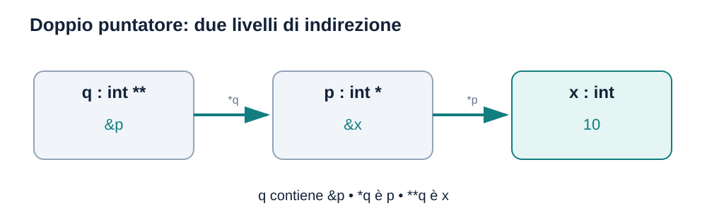
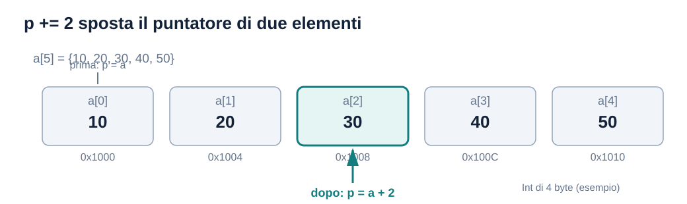
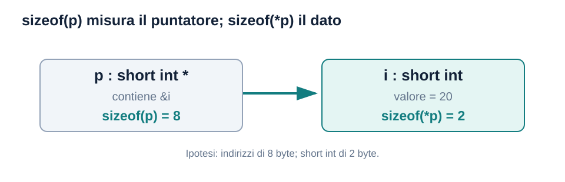
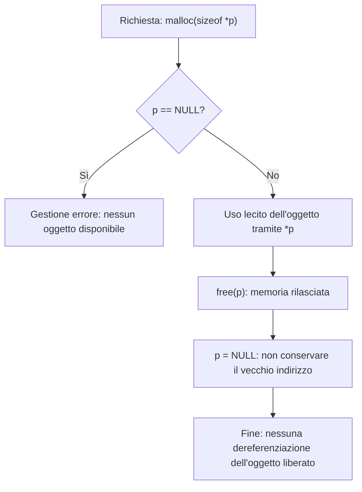
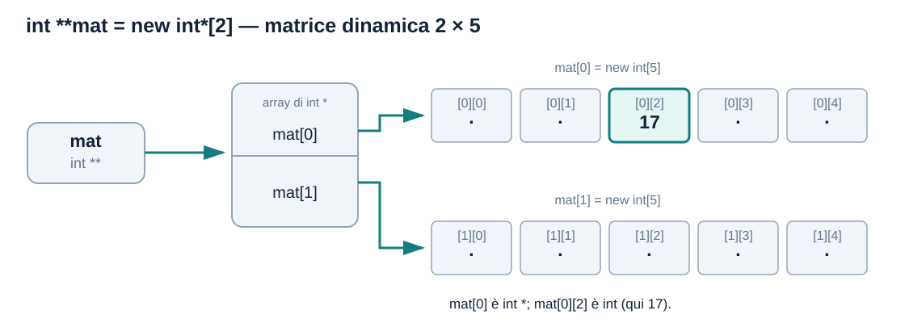

# Puntatori — approfondimento mirato per la teoria di Programmazione 1

> **Ambito:** puntatori e memoria in **C**, con una sezione separata per `new`/`delete` in **C++** perché presenti negli appelli teorici. Materiale basato sulla dispensa **6.1 Puntatori**, sulle domande originali d'esame indicate in fondo e sugli approfondimenti svolti durante lo studio.
>
> **Non trattati qui:** puntatori come parametri di funzione e passaggio per indirizzo. Verranno affrontati nell'approfondimento **Funzioni**.
>
> Gli esempi didattici creati per spiegare un concetto sono distinti dagli **esercizi originali d'esame**. Le figure SVG sono incorporate nel Markdown e disponibili come file nel repository.

## 1. Che cos'è un puntatore?

Un **puntatore è una variabile il cui valore è un indirizzo di memoria**. Il puntatore occupa **memoria propria**, separata da quella dell'oggetto a cui punta.

```c
int x = 10;
int *p = &x;
```


Nell'immagine gli indirizzi sono **inventati**: servono soltanto a mostrare che:

- `x` contiene `10` e possiede un indirizzo, per esempio `0x1000`.
- `p` contiene **l'indirizzo di `x`** (`0x1000`).
- `p` è esso stesso una variabile, collocata per esempio all'indirizzo `0x2000`.
- `&p` è l'indirizzo **della variabile puntatore**; è diverso da `p`, che è l'indirizzo dell'oggetto puntato.

### Gli operatori `&` e `*`

- **Referenziazione / operatore di indirizzo `&`:** `&x` ricava l'indirizzo di `x`.
- **Dereferenziazione `*`:** `*p` accede all'oggetto il cui indirizzo è memorizzato in `p`.
- Nella **dichiarazione** `int *p`, `*` specifica invece che `p` ha un tipo puntatore: **non** è una dereferenziazione.

| Espressione | Tipo | Significato |
|---|---|---|
| `x` | `int` | Valore dell'intero |
| `&x` | `int *` | Indirizzo di `x` |
| `p` | `int *` | Indirizzo memorizzato in `p` (nell'esempio, `&x`) |
| `*p` | `int` | Intero puntato da `p` |
| `&p` | `int **` | Indirizzo della variabile `p` |

```c
*p = 20;  // modifica x: ora x == 20
```

**Attenzione:** `int *p;` crea la variabile `p`, **non** un `int` a cui `p` punti. Dereferenziare un puntatore automatico non inizializzato ha comportamento indefinito; prima di `*p` serve un indirizzo valido.

### Indirizzi: binario o esadecimale?

(La stampa degli indirizzi con `printf("%p", ...)` e il dettaglio sul formato `%p` non sono presentati nelle slide; approfondimento pratico.)

L'indirizzo è rappresentato nella memoria secondo la rappresentazione dei puntatori dell'implementazione. La **notazione esadecimale** (`0x1000`) è una modalità usuale per **scrivere o visualizzare** un indirizzo, non il suo «tipo».

```c
#include <stdio.h>

int x = 10;
int *p = &x;
printf("%p\n", (void *)p);  // stampa una rappresentazione dell'indirizzo
```

L'output esatto varia tra esecuzioni e sistemi; `%p` usa un formato definito dall'implementazione, comunemente esadecimale.

## 2. Tipi `int *`, `int **`, `int ***`

(Il **triplo puntatore** `int ***` è un'estensione didattica non presente nelle slide: la dispensa 6.1 tratta esplicitamente il **doppio puntatore** `int **`.)

Un tipo puntatore include il **tipo dell'oggetto puntato**. Ogni ulteriore `*` nella dichiarazione indica un nuovo livello d'indirezione.

```c
int x = 10;
int *p = &x;       // puntatore a int
int **q = &p;      // puntatore a int *
int ***r = &q;     // puntatore a int **
```



| Espressione | Tipo | Valore nel codice |
|---|---|---|
| `p` | `int *` | `&x` |
| `q` | `int **` | `&p` |
| `*q` | `int *` | Il valore contenuto in `p`, cioè `&x` |
| `**q` | `int` | `10` |
| `***r` | `int` | `10` |

```c
**q = 20;   // modifica x
*q = &x;    // modifica p: p torna/continua a puntare a x
```

**Errore di tipi da evitare:**

```c
q = &p;     // valido: int ** <- int **
*q = &p;    // non compatibile: int * <- int **
*q = &x;    // valido: int * <- int *
**q = 20;   // valido: int <- int
```

In C una dichiarazione come `int *p, q;` definisce `p` puntatore e `q` **intero**. Per due puntatori scrivere `int *p, *q;`.

### Due puntatori alla stessa variabile (aliasing)

```c
int x = 4, y = 9;
int *p = &x;
int *q = p;

*q = 6;     // x diventa 6
p = &y;     // cambia soltanto il contenuto del puntatore p
*p += 1;    // y diventa 10
```

Alla fine `x == 6`, `y == 10`, `*q == 6` e `*p == 10`.

**Perché `q` continua a puntare a `x`?** `q = p` ha **copiato l'indirizzo** contenuto in `p`; non ha collegato tra loro le variabili puntatore. Cambiando `p`, `q` non si aggiorna.

Nel caso `int **q = &p;`, invece, `q` memorizza l'indirizzo **della variabile `p`**: cambiare `p` modifica il risultato di `*q` e di `**q` (se il nuovo `p` è dereferenziabile), ma non il contenuto di `q`.

## 3. Verifica della validità delle operazioni — esame reale 22/10/2024

**[Prima prova teorica del 22/10/2024, domanda 1, 1 punto](../../Prove_Teoriche/22102024%201_ProvaTeorica%20PROG1.pdf).**

Dichiarazioni dell'esame:

```c
int i = 1;
int *pi;
pi = &i;
```

La domanda chiede di indicare se le seguenti istruzioni sono **ammissibili**:

| Istruzione | Ammissibile? | Spiegazione |
|---|---|---|
| `*pi = 7;` | **Sì** | Assegna 7 a `i` tramite `pi` |
| `pi = i;` | **No** | Un `int` non è assegnabile a `int *` in questo caso |
| `*pi = i;` | **Sì** | Assegna un `int` a un altro `int` |
| `*pi++;` | **Sì** | È `*(pi++)`: usa l'indirizzo originario e poi incrementa il puntatore |

Le quattro affermazioni vero/falso presenti nella stessa domanda:

| Affermazione | Risposta | Perché |
|---|---|---|
| Si può dereferenziare un puntatore non inizializzato | **Falso** | Indirizzo indeterminato; accesso non valido |
| Dichiarare un puntatore alloca la variabile puntata | **Falso** | Alloca soltanto la **variabile puntatore** |
| Puntatori a tipi diversi sono sempre compatibili | **Falso** | Compatibilità e conversioni dipendono dai tipi; `void *` è un caso particolare |
| La dimensione in memoria di un puntatore dipende dal tipo puntato | **Generalmente falso nel modello del corso** | Per i normali puntatori ai dati sulle piattaforme usuali la dimensione è la stessa. Lo standard C non obbliga *tutti* i tipi puntatore ad avere la medesima dimensione **(precisazione dello standard non esplicitata nelle slide)** |

**Nota su `*pi++;`:** siccome `pi` punta al solo oggetto `i`, dopo `pi++` assume il valore *one-past* rispetto a quell'oggetto; non è lecito dereferenziarlo mentre è in tale posizione. Il codice **non** incrementa `i`. (La nozione formale di puntatore *one-past* non è sviluppata nelle slide.)

## 4. Puntatori e array: aritmetica

Nella dispensa 6.1 sono richiamate le equivalenze:

```c
int a[5] = {10, 20, 30, 40, 50};
int *p = a;            // uguale a &a[0]

a[i] == *(a + i)
p[i] == *(p + i)
```

L'indicizzazione è una forma di dereferenziazione con spostamento. Un puntatore può avanzare di **elementi del tipo puntato**, non di un numero fisso di byte.

```c
p += 2;        // ora p == &a[2] e *p == 30
```



Se `sizeof(int) == 4`, aggiungere `2` a un `int *` aumenta l'indirizzo di **8 byte**. La distanza dipende dal tipo, ma l'operazione si esprime sempre in elementi.

| Operazione | Effetto |
|---|---|
| `p + 3` | Restituisce l'indirizzo di tre elementi successivi, senza modificare `p` |
| `p += 3` / `p = p + 3` | Sposta `p` di tre elementi |
| `p--` | Sposta `p` all'elemento precedente |
| `p - q` | Distanza **in elementi** tra due puntatori riferiti allo stesso array |
| `p + q` | **Non ammesso** |
| `a = p;` o `a++;` | **Non ammessi**: l'identificatore dell'array non è una variabile puntatore modificabile |

> **Limiti:** la normale aritmetica dei puntatori è definita soltanto entro lo stesso array (oppure fino alla posizione **subito dopo** l'ultimo elemento). Il puntatore one-past può essere formato, ma **non dereferenziato**. Per il calcolo della differenza `p-q` occorre anche che il risultato sia rappresentabile in `ptrdiff_t` (**dettaglio formale e tipo `ptrdiff_t` non trattati nelle slide**).

## 5. Precedenza di `*` e `++` — il punto più insidioso

Il `++` **postfisso** ha precedenza maggiore della dereferenziazione; i `++` **prefissi** e `*` unario appartengono alla stessa categoria di precedenza, con associazione da destra a sinistra.

| Espressione | Espansione intuitiva | Modifica | Valore dell'espressione |
|---|---|---|---|
| `(*p)++` | `(*p)++` | Dato puntato | Vecchio valore del dato |
| `++*p` | `++(*p)` | Dato puntato | Nuovo valore del dato |
| `*p++` | `*(p++)` | Puntatore | Vecchio elemento puntato |
| `*++p` | `*(++p)` | Puntatore | Nuovo elemento puntato |

### Tracciamento ragionato (esempio illustrativo)

```c
int a[4] = {10, 20, 30, 40};
int *p = a;

int r1 = *p++;    // r1=10; p -> a[1]; a invariato
int r2 = ++*p;    // a[1]=21; r2=21; p resta su a[1]
int r3 = *++p;    // p -> a[2]; r3=30
int r4 = (*p)++;  // r4=30; a[2]=31; p resta su a[2]
```

**Stato finale:**

```text
a  = {10, 21, 31, 40}
p  = &a[2]
r1 = 10
r2 = 21
r3 = 30
r4 = 30
```

### Esempio della dispensa 6.1 Puntatori

```c
int arr[3] = {0, 0, 0};
int *p = arr;
*p++ = 20;
```

L'assegnazione scrive `20` in `arr[0]` e poi incrementa `p`. **Risultato:** `arr = {20, 0, 0}` e `p == &arr[1]`.

**Attenzione:** non bisogna confondere `(*p)++` con `*p++`: **le parentesi cambiano quale oggetto viene incrementato**.

## 6. `sizeof`: dimensione del puntatore o del dato puntato?

`sizeof` restituisce la dimensione, in **byte C**, del tipo o dell'espressione. Il risultato è di tipo `size_t`, stampabile con `%zu` (**questi dettagli su `size_t` e `%zu` non compaiono nelle slide; l'operatore `sizeof` invece è trattato**).



### Esercizio reale — 10/02/2025, domanda 5 (1 punto)

**[Prova teorica 10/02/2025](../../Prove_Teoriche/100225%20ProvaTeorica%20PROG1.pdf)**:

```c
short int i = 20;
char c = 97;
short int *pi = &i;
```

L'esame specifica: **8 byte per un indirizzo**. La seguente tabella assume inoltre le dimensioni usuali **`short int = 2` byte** e **`int = 4` byte**, che non sono universalmente fissate dal linguaggio.

| Espressione originale | Dimensione | Perché |
|---|---:|---|
| `sizeof(i)` | 2 | Tipo `short int` |
| `sizeof(&i)` | 8 | Tipo `short int *` |
| `sizeof(pi)` | 8 | Tipo `short int *` |
| `sizeof(*pi)` | 2 | Tipo `short int` |
| `sizeof(&pi)` | 8 | Tipo `short int **` |
| `sizeof(c)` | 1 | `char` occupa 1 byte C per definizione |
| `sizeof(&c)` | 8 | Tipo `char *` |
| `sizeof(c + i)` | 4 | `char` e `short int` vengono promossi a `int`, nelle ipotesi considerate |

**L'insidia finale:** `sizeof(c + i)` non somma `sizeof(c) + sizeof(i)`. Misura il **tipo risultante** dell'espressione `c + i`; con le usuali promozioni intere è un `int`.

### Confronto tra array e puntatore

```c
int a[10];
int *p = a;
```

Se `sizeof(int) == 4` e `sizeof(int *) == 8`:

```text
sizeof(a)   = 40   // array intero (10 × 4)
sizeof(p)   = 8    // variabile puntatore
sizeof(*p)  = 4    // singolo int
sizeof(&p)  = 8    // puntatore al puntatore
```

**Da ricordare:** una variabile array **non è** una variabile puntatore, anche se in molti contesti l'espressione array viene convertita in un puntatore al primo elemento. `sizeof(a)` è proprio uno dei casi in cui questa conversione non avviene.

## 7. Puntatori invalidi, `NULL` e durata della memoria

(I puntatori non inizializzati e `NULL` sono presenti nella dispensa 6.1; **dangling pointer, `free` e doppia deallocazione sono approfondimenti non trattati nelle slide**.)

| Situazione | Conseguenza |
|---|---|
| `int *p;` locale senza inizializzazione | `p` ha valore indeterminato: **non usarlo come indirizzo** |
| `int *p = NULL;` | Puntatore nullo, non dereferenziabile |
| `p = &x;` con `x` ancora in vita | Puntatore valido a `x` |
| Puntatore a oggetto la cui vita è terminata | Puntatore **dangling**: non dereferenziare |
| `free(p);` sulla corretta memoria dinamica | La memoria puntata viene rilasciata; `p` non viene eliminato |
| `*p` dopo aver liberato la memoria | Comportamento indefinito |
| Liberare due volte la stessa allocazione | Comportamento indefinito |

`NULL` è definito, tra gli altri, in `<stddef.h>` e `<stdlib.h>`.

**Distinzione importante:** dichiarare `int x = 10; int *p = &x;` non richiede `malloc`. La memoria di variabili locali ordinarie viene gestita automaticamente e la loro durata termina quando termina il blocco appropriato. **Non chiamare `free(&x)`**: `free` si applica solo a memoria dinamica ottenuta con funzioni di allocazione compatibili.

## 8. Allocazione e deallocazione in C — `malloc` / `free`

(**Funzioni `malloc` e `free` non presenti né spiegate nelle slide caricate**: approfondimento sulla memoria dinamica, che nelle dispense è soltanto menzionata. Anche i termini *memory leak*, *double free* e *dangling pointer* non sono trattati esplicitamente nelle slide.)

- **Allocazione:** ottenere una regione di memoria in cui conservare dati.
- **Deallocazione:** rilasciare una regione precedentemente allocata, rispettandone la provenienza.
- Un puntatore locale e la regione allocata dinamicamente da `malloc` occupano **spazi distinti**.

```c
#include <stdlib.h>

int main(void) {
    int *p = malloc(sizeof *p);  // memoria per un int

    if (p == NULL)
        return 1;               // allocazione fallita

    *p = 20;

    free(p);                    // libera l'int allocato
    p = NULL;                   // evita di conservare quel vecchio indirizzo
    return 0;
}
```

`free(p)` **non dealloca la variabile locale `p`**: libera l'oggetto dinamico a cui `p` si riferiva. Dopo `free` il valore del puntatore diventa inutilizzabile come riferimento a quell'oggetto; `p = NULL` lo reimposta esplicitamente.

### Schema della vita della memoria dinamica



**Memory leak:** perdere tutti i riferimenti utili a una regione allocata senza averla liberata. **Double free:** deallocare due volte la stessa regione. **Dangling pointer:** un puntatore che conserva il riferimento a memoria non più valida.

## 9. Allocazione e deallocazione in C++ — `new` / `delete`

(**`new`, `delete`, `new[]`, `delete[]` e `nullptr` non sono trattati nelle slide caricate;** sono mantenuti perché `new`/`delete` compaiono negli esercizi d'esame del 10/02/2025 e 03/09/2025. `nullptr` è un dettaglio ulteriore del C++.)

> **Attenzione per il corso:** le domande del **10/02/2025** e del **03/09/2025** usano `new` e `delete`, che sono **C++**, non C standard. Non mescolare `malloc/free` e `new/delete` per la stessa allocazione.

| Espressione C++ | Alloca | Da liberare con |
|---|---|---|
| `new int(5)` | Un singolo `int` inizializzato a **5** | `delete p;` |
| `new int[5]` | Un array di **cinque** `int`; elementi non inizializzati se di durata dinamica senza inizializzatore | `delete[] p;` |
| `new int[5]()` | Un array di cinque `int` inizializzati a **0** | `delete[] p;` |
| `new int*[2]` | Un array di **due puntatori a `int`** | `delete[] p;` |

### Esercizio reale — 10/02/2025, domanda 2 (2 punti)

**[PDF originale della prova](../../Prove_Teoriche/100225%20ProvaTeorica%20PROG1.pdf)**. Viene chiesto di correggere sette errori/imprecisioni in un codice per una matrice dinamica **2×5**.

**Codice errato dell'esame:**

```cpp
int** mat = new int*;
int mat[0] = new int[5];
int mat[1] = new int(5);
// altre istruzioni
delete mat;
```

**Codice corretto** (parte di allocazione e deallocazione):

```cpp
int **mat = new int*[2];  // due puntatori alle righe
mat[0] = new int[5];      // prima riga: 5 interi
mat[1] = new int[5];      // seconda riga: 5 interi

mat[0][2] = 17;          // elemento [riga 0][colonna 2]
mat[1][4] = 99;          // elemento [riga 1][colonna 4]

// Deallocazione: prima le righe, poi l'array di puntatori
delete[] mat[0];
delete[] mat[1];
delete[] mat;
mat = nullptr;           // C++11 e successivi
```



**Perché `mat[0][2]` è un intero e non un indirizzo?**

```cpp
mat           // tipo int **: punta a un array di int *
mat[0]        // tipo int *:  punta alla riga 0
mat[0][2]     // tipo int:    terzo intero della riga 0

mat[0]     == *(mat + 0)
mat[0][2]  == *(*(mat + 0) + 2)
```

Sono **due livelli di indirezione**: il primo indice raggiunge il puntatore alla riga, il secondo il singolo elemento `int`.

### I sette errori da riconoscere nell'esame

| Errore | Correzione / spiegazione |
|---|---|
| `new int*` | Alloca **un** `int*`, non due: serve `new int*[2]` |
| `int mat[0] = ...` | Forma di dichiarazione errata; serve l'assegnazione `mat[0] = ...` |
| `int mat[1] = ...` | Stesso errore: `mat[1] = ...` |
| `new int(5)` | Un solo intero di valore 5, non un array: serve `new int[5]` |
| Manca `delete[] mat[0]` | La prima riga va liberata |
| Manca `delete[] mat[1]` | La seconda riga va liberata |
| `delete mat` | Deve essere `delete[] mat`, perché l'allocazione esterna usa `new[]` |

Tre chiamate di allocazione (`new[]` per i due puntatori e una per ciascuna riga) richiedono **tre deallocazioni** corrispondenti. Ogni riga è una regione separata; non è obbligatorio che le due righe siano contigue in memoria.

**Attenzione:** `delete mat` al posto di `delete[] mat` non è una «liberazione parziale»: il mismatch fra `new[]` e `delete` comporta **comportamento indefinito**.

### Esercizio reale — 03/09/2025, domanda 1 (3 punti)

**[PDF originale della prova](../../Prove_Teoriche/030925%20ProvaTeorica%20PROG1.pdf)**. Il codice errato è dello **stesso tipo** e usa la variabile `V`:

```cpp
int** V = new int*;
int V[0] = new int[5];
int V[1] = new int(5);
// codice per deallocazione
delete V;
```

Le correzioni concettuali sono le stesse dell'appello di febbraio: **array di due puntatori**, **due array da cinque interi**, **`delete[]` per ciascuna riga** e **`delete[] V`** per l'array esterno.

### Riepilogo: allocazioni incompatibili

```cpp
int *a = new int(5);
delete a;         // corretto

int *b = new int[5];
delete[] b;       // corretto

// delete b;       // errato: mismatch con new[]
// free(a);        // errato: non mescolare free con new
```

## 10. Altri dettagli presenti nella dispensa 6.1

### `const` e puntatori

```c
int x = 10, y = 20;

const int *p = &x;      // non modificare *p attraverso p; p può cambiare
int *const q = &x;      // q non può essere riassegnato; *q può cambiare
const int *const r = &x; // né r né *r sono modificabili tramite r
```

La collocazione di `const` determina se è vincolato il **dato raggiunto dal puntatore**, il **puntatore stesso**, oppure entrambi. È materiale della dispensa; non viene qui associato a una specifica domanda verificata.

### Puntatori a strutture

```c
struct S { int valore; };
struct S s = {7};
struct S *ps = &s;

s.valore     // 7
(*ps).valore // 7
ps->valore   // 7: forma abbreviata di (*ps).valore
```

## 11. Checklist rapida per gli esercizi teorici

1. **Tipo di ogni espressione:** `int`, `int *`, `int **`? Ogni `&` aggiunge un livello; ogni dereferenziazione `*` ne elimina uno.
2. **Oggetto modificato:** un'istruzione cambia **l'indirizzo nel puntatore** o **il valore puntato**?
3. **Precedenza:** `*p++` è `*(p++)`, mentre `(*p)++` incrementa il valore puntato.
4. **Validità:** il puntatore è inizializzato? Punta a memoria ancora viva? L'accesso è dentro i limiti?
5. **Array:** gli indici equivalgono a spostamento + dereferenziazione; `sizeof(array)` non equivale a `sizeof(puntatore)`.
6. **`sizeof`:** determinare il **tipo dell'espressione**, non il valore numerico; ricordare le promozioni intere.
7. **Allocazione:** distinguere oggetto singolo e array, abbinare correttamente `malloc/free` oppure `new/delete`, `new[]/delete[]` (**non presenti nelle slide; `new/delete` compare nelle prove d'esame**).
8. **Matrici via `int **`:** prima raggiungere il puntatore alla riga, poi l'intero; deallocare **prima le righe e poi l'array esterno**.

## Riferimenti e provenienza

- **Dispensa 6.1 Puntatori:** indirizzi, `*` e `&`, doppio puntatore, precedenza operatori, aritmetica, array, `const`, accesso tramite `->`, esercizio `*p++ = 20`.
- **[22/10/2024 — Prima prova teorica, domanda 1](../../Prove_Teoriche/22102024%201_ProvaTeorica%20PROG1.pdf):** correttezza delle istruzioni con `pi` e vero/falso sulla memoria dei puntatori.
- **[10/02/2025 — Prova teorica, domanda 2](../../Prove_Teoriche/100225%20ProvaTeorica%20PROG1.pdf):** correzione di matrice dinamica in C++ con `int **`, `new` e `delete`.
- **[10/02/2025 — Prova teorica, domanda 5](../../Prove_Teoriche/100225%20ProvaTeorica%20PROG1.pdf):** otto espressioni `sizeof`.
- **[03/09/2025 — Prova teorica, domanda 1](../../Prove_Teoriche/030925%20ProvaTeorica%20PROG1.pdf):** esercizio analogo sulla matrice dinamica in C++.

> La selezione riporta **domande d'esame effettivamente verificate** e materiale della dispensa, ma **non** pretende di essere un censimento esaustivo di tutte le domande sui puntatori nei 50 esami. I casi in cui compaiono puntatori **come parametri di funzione** saranno sviluppati nella successiva lezione mirata **Funzioni**.
